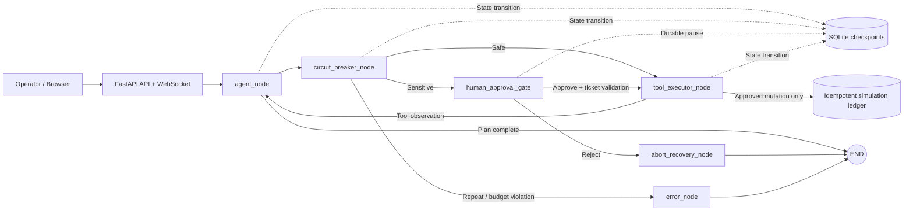
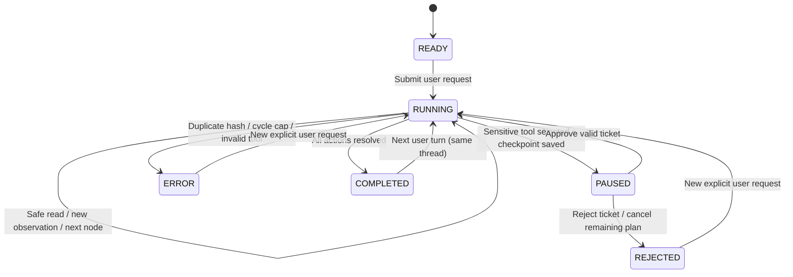

# StateGuard - Enterprise ReAct Control-Flow Simulator

**Deterministic state graph | Persistent conversational memory | SHA-256 circuit breaker | Human-in-the-loop (HITL) approvals | FastAPI dashboard**

StateGuard is a locally runnable operations-agent prototype that demonstrates how explicit state transitions contain the failure modes of unconstrained ReAct loops. A custom directed state graph governs planning, tool execution, approvals, errors, and termination. SQLite checkpoints persist session state across turns and approval pauses. A browser dashboard exposes live events, node transitions, human approval cards, and the current checkpoint JSON.

> **Simulation-only safety boundary:** All cloud metrics and billing values are mock data. Kubernetes scaling and wire transfers are recorded in a local SQLite *simulation ledger*; **no actual cluster resources are changed and no real money is moved.** The default constrained planner requires **no OpenAI API key, no paid API, and no external credentials**. This is a deterministic ReAct-style educational implementation, not a production-integrated autonomous LLM service.

## Architecture



### State lifecycle and conditional transitions



**Graph engine:** Custom Directed State Graph Engine (not LangGraph). **Checkpointer:** SQLite-backed session snapshots (`src/checkpoint.py`). **UI:** FastAPI + native HTML/CSS/JavaScript + WebSocket checkpoint notifications. **Planner:** Constrained deterministic tool selection and observation-based conditional routing; optionally an actual on-device Ollama model can propose validated tool calls with no paid APIs.

## Key capabilities

| Capability | Implementation |
| --- | --- |
| Explicit graph nodes | `agent_node`, `circuit_breaker_node`, `human_approval_gate`, `tool_executor_node`, `error_node`, `abort_recovery_node`, `END` |
| Typed state schema | `AgentState` with messages, iterations, hashes, approvals, plan, observations, and event log |
| Short-term memory | Session-scoped `facts` and chat history persisted in SQLite by unique `thread_id` |
| Hard cycle bound | Maximum six reasoning cycles per request, plus an outer graph-transition safety cap |
| Duplicate call detection | SHA-256 of `tool_name` + canonical JSON arguments with sorted keys; six-hash window |
| Sensitive-tool gate | Pause persists approval ticket before tool execution; user must Approve or Reject |
| Safe rejection | Dedicated abort/recovery node; cancellation recorded and no repeated approval loop |
| Idempotency | Unique simulated mutation receipt; prevents repeat writes on an approval replay |
| QA | Automated tests across graph flow, memory, circuit breakers, HITL, API, and WebSocket |

## Tool registry and risk policy

| Tool | Safety classification | Behavior |
| --- | --- | --- |
| `query_service_metrics(service_name: str)` | **Safe - read-only** | Returns fixture metrics; `auth-service` has 8.2% error rate |
| `check_billing_balance(account_id: str)` | **Safe - read-only** | Returns fixture balances such as `DEMO-100` |
| `scale_kubernetes_cluster(service_name: str, replica_count: int)` | **Sensitive - infrastructure** | Requires HITL; records a **simulated** scale action |
| `execute_wire_transfer(recipient_id: str, amount_usd: float)` | **Sensitive - financial** | Requires HITL; records a **simulated** transfer |

Sensitive tool requests are validated against a matching human approval ticket **at the execution boundary**, not just in the browser. The ticket is bound to the session run, tool name, normalized argument fingerprint, and exact arguments. Unauthorized or stale approval attempts are rejected. Tools never access actual cloud or banking accounts.

## Environment and installation

Requirements: Python **3.11+**, [`uv`](https://docs.astral.sh/uv/), a modern browser. No API keys are required.

```bash
# Clone the repository after publishing it, or open the project folder directly.
cd stategraph-react-agent

uv python pin 3.11
uv sync --extra dev
```

To use a custom checkpoint path, create `.env` from `.env.example` and export `AGENT_DB_PATH` in the environment before launching; no `.env` file is loaded automatically. By default the database is created at `data/checkpoints.db`.

Start the dashboard:

```bash
uv run uvicorn src.app:app --host 127.0.0.1 --port 8000 --reload
```

Open **http://127.0.0.1:8000**. API docs are available at **http://127.0.0.1:8000/docs**.

If `uv` is unavailable, an equivalent Python virtual environment works:

```bash
python3 -m venv .venv
source .venv/bin/activate
pip install -e ".[dev]"
uvicorn src.app:app --host 127.0.0.1 --port 8000
```

## Optional local LLM tool calling (no cloud API key)

The project runs entirely offline with `AGENT_PLANNER=deterministic` by default. For an **actual model-backed tool-calling step** inside `agent_node`, you can install the free local [Ollama](https://ollama.com/) runtime and a tool-calling model, then run:

```bash
ollama pull qwen2.5:3b
AGENT_PLANNER=ollama OLLAMA_MODEL=qwen2.5:3b uv run uvicorn src.app:app --host 127.0.0.1 --port 8000
```

The module `src/local_model.py` uses Ollama's local `/api/chat` tool interface at `http://127.0.0.1:11434` and **does not send user data to any paid cloud provider**. This optional step asks the LLM to propose the next tool call based on the operator goal and previous observations. The model's output is checked against the graph's deterministic, prevalidated plan; new tools or changed arguments are discarded. If Ollama is not running, the graph logs a fallback message and the deterministic execution continues. **The LLM cannot approve its own sensitive tool calls.**

The offline workflow remains the recommended grading/demo path when no local model is installed. A genuine LLM demo requires a running Ollama model and adequate local RAM.

## Containerized local deployment (Option B)

The repository includes a `Dockerfile` and `docker-compose.yml` for a persistent single-container demo. Docker Compose binds the dashboard to local port **8000** and retains SQLite checkpoints in a named volume. No public cloud account is required.

```bash
docker compose up --build -d
docker compose ps
curl http://127.0.0.1:8000/healthz
docker compose logs --tail=30 stateguard
```

Open **http://127.0.0.1:8000**. To stop the container while preserving state:

```bash
docker compose down
```

To remove all stored **demo** state intentionally, run `docker compose down -v`. The image runs as an unprivileged user and uses Python 3.11. Do not run the local uvicorn server and Docker container on port 8000 simultaneously. Docker deployment must be verified on a machine with a working Docker engine; this is a local-demo deployment, not a hosted URL.

## Functional walkthrough

### 1. Read-only execution

Enter the prompt:

```text
Check the current error rate on auth-service.
```

The runtime traverses `agent_node -> circuit_breaker_node -> tool_executor_node -> agent_node -> END`. The read-only tool executes without a human interruption.

### 2. Session memory checkpointing

Run two requests under the **same** session identifier:

```text
My name is Alice
What is my name?
```

The reply correctly recalls `Alice`. Open a new session and repeat the question to verify cross-session isolation. Restart the server to verify the same session is still accessible by its thread ID.

### 3. Conditional incident-response workflow

```text
Check the current error rate on auth-service. If it's over 5%, scale its replicas to 10 and transfer $1,500 to the contracted on-call engineering firm (Vendor ID: V-8812) for emergency mitigation.
```

The `auth-service` fixture returns **8.2%**, exceeding the **5%** threshold. The graph pauses before scaling, displays a **HIGH - INFRASTRUCTURE** approval card, and persists the checkpoint. Approve to resume; the second mutation produces a separate **HIGH - FINANCIAL** approval card. Both can be approved individually. The final chat message contains simulated operation receipts.

Run the scenario again in a new session and **Reject** the first request to observe `abort_recovery_node -> END` and zero mutation records.

For a conditional skip, use `healthy-service` (mock error rate **0.3%**) and an above-5% scaling threshold; no approval is requested.

### 4. Repeated-call circuit breaker

Check **Inject failing tool call** and submit any nonempty prompt. The injected safe metrics tool returns a simulated `503` error. A second identical proposed tool call matches its normalized SHA-256 payload against the current run's hash window. The graph trips the breaker, transitions through `error_node`, and stops without infinite retries. The live event log and state drawer expose the reason.

## Human approval and durable resumption

1. The reasoning node chooses a pending tool call from the structured plan.
2. The circuit-breaker node validates its payload and enforces cycle bounds.
3. If the registry marks the tool `is_sensitive=True`, the runtime creates a UUID approval ticket.
4. The graph transitions to `human_approval_gate`, writes a SQLite checkpoint, returns `PAUSED`, and displays the approval UI.
5. **Approve:** The client supplies the exact `thread_id` + `ticket_id`. The graph validates the ticket and resumes at `tool_executor_node`; a stable idempotency key prevents duplicate simulated mutations.
6. **Reject:** The graph routes to `abort_recovery_node`, records an explicit rejection observation, cancels remaining planned actions, and ends without replaying the denied call.
7. After either decision, the checkpoint is updated. A server restart can reload an unresolved paused session and continue from the saved state.

## API endpoints

| Method | Endpoint | Purpose |
| --- | --- | --- |
| `GET` | `/` | Web dashboard |
| `GET` | `/healthz` | Health endpoint |
| `POST` | `/api/sessions` | Create isolated session (UUID) |
| `GET` | `/api/state/{thread_id}` | Inspect SQLite-backed checkpoint |
| `POST` | `/api/submit` | Start a bounded graph execution |
| `POST` | `/api/decide` | Approve/reject a specific approval ticket |
| WebSocket | `/ws/{thread_id}` | Stream new checkpoint snapshots |

Example read-only request using an existing session ID:

```bash
curl -X POST http://127.0.0.1:8000/api/submit \
  -H 'Content-Type: application/json' \
  -d '{"thread_id":"YOUR_SESSION_ID","prompt":"Check auth-service error rate"}'
```

## Automated QA

```bash
uv run pytest -v
```

Test coverage includes autonomous safe traversal, multi-turn memory, session isolation, SQLite restart recovery, conditional skips, multiple approvals, six-cycle caps, normalized payload hashing, duplicate error detection, rejection recovery, authorization bypass prevention, idempotency, API routes, and WebSocket state delivery. The suite is in `tests/`; reproduce the run locally before citing its output as evidence.

## AI generation and audit

The AI-assisted baseline is preserved at `audit/baseline_v0.py` **only as evidence** and is intentionally not imported by the active app. `ai_prompt_log.md` documents the original prompt, defect severity, before/after diffs, corrections, and tests verifying the remediations. Reviewed defects include:

- In-place shared state mutation instead of immutable node returns.
- Unnormalized `str(dict)` hashing that fails on reordered arguments.
- Rejection returning to the agent without clearing the denied action.
- Hardcoded cross-session IDs.
- Missing executor-side authorization checks.

## Repository structure

```text
stategraph-react-agent/
├── assets/
│   ├── index.html                # Original control center interface
│   ├── style.css                 # Responsive dashboard styling
│   └── app.js                    # Browser state and HITL event logic
├── audit/
│   └── baseline_v0.py           # Archived insecure sketch (never imported)
├── data/                          # Local SQLite database (gitignored)
├── .github/workflows/tests.yml     # Automated CI for pytest
├── Dockerfile                     # Python 3.11 container image
├── docker-compose.yml             # Persistent local demo deployment
├── src/
│   ├── app.py                    # FastAPI / WebSocket interface
│   ├── checkpoint.py             # SQLite state snapshots and operation ledger
│   ├── circuit_breaker.py        # Canonical SHA-256 and repetition policy
│   ├── graph.py                  # State transitions and checkpointed HITL
│   ├── local_model.py            # Optional on-device Ollama tool calling
│   ├── planner.py                # Offline tool-intent policy and conditions
│   ├── state.py                  # Typed state and immutable updates
│   └── tools.py                  # Mock tools, strict validation and risk policy
├── tests/
│   ├── test_api.py
│   ├── test_cycle_breaker.py
│   ├── test_graph_flow.py
│   └── test_hitl_approval.py
├── .env.example
├── ai_prompt_log.md
├── pyproject.toml
└── README.md
```

## Design constraints and limitations

- **Educational scope:** This simulator has no actual LLM inference in its default policy mode (optional on-device Ollama calls are supported), no production credentials, no real payment rail, and no Kubernetes client. It demonstrates the state graph, observations, conditional transitions, and runtime policy gates deterministically.
- **No production authentication:** The API exposes state by session ID, suitable for localhost demos only. Do not make this public without authentication, authorization, CSRF protections, audit controls, and rate limiting.
- **Single-host execution:** SQLite transactions protect saved versions and simulated operation receipts. The in-memory session lock is process-local and is not a distributed execution lock.
- **External side effects:** A production tool adapter would need transaction-aware idempotency, compensating actions, operator identity, and an external durable action ledger.
- **Failure budgets:** A strict per-turn six-cycle cap and repeated-payload detector are enforced in the execution runtime, never left to the model to self-regulate.

**Engineering principle:** *Reasoning proposes; deterministic code controls; the operator authorizes.*
